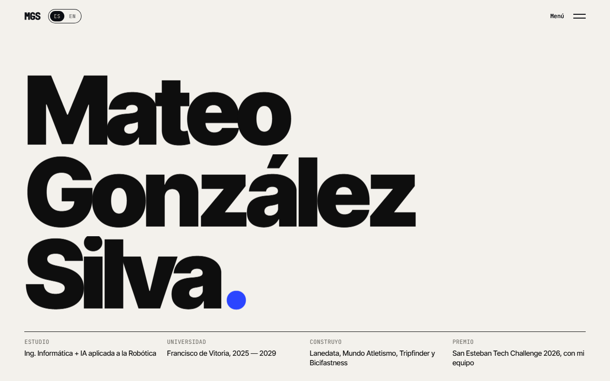

<h1 align="center">mateogsilvaa.es</h1>
<p align="center">
  Personal website of Mateo González Silva: projects, experience and education, in Spanish and English.
</p>
<p align="center">
  <a href="https://mateogsilvaa.es"><b>Visit the website</b></a> ·
  <a href="https://mateogsilvaa.es/en/">English version</a> ·
  <a href="https://www.linkedin.com/in/mateogonzalezsilva">LinkedIn</a>
</p>
<p align="center">
  <a href="https://mateogsilvaa.es"></a>
</p>

## About

A static site in HTML, CSS and JavaScript, with no framework or bundler.

- **Bilingual.** The English pages are generated from the Spanish ones.
- **Reduced motion.** Respects `prefers-reduced-motion`.
- **Discoverable.** Sitemap, `hreflang` links and `llms.txt`.
- **CV included.** HTML source and PDF, in both languages.

## Project structure

| Path | Contents |
|---|---|
| `index.html` and page folders | Spanish pages |
| `en/` | English pages, generated |
| `_i18n/` | Translations and generator scripts |
| `site.css`, `site.js` | Shared design and behaviour |
| `cv/` | CV in Spanish and English |
| `assets/` | Images, brand and project media |

## Development

```bash
git clone https://github.com/mateogsilvaa/portfolio.git
cd portfolio
npx serve -l 3789 .
```

After editing a Spanish page or a translation, regenerate the English version:

```bash
python _i18n/gen_en.py
```

Published with GitHub Pages.

## Credits

Certification logos belong to their owners: Anthropic, Cambridge, Cisco and MathWorks.

© Mateo González Silva
